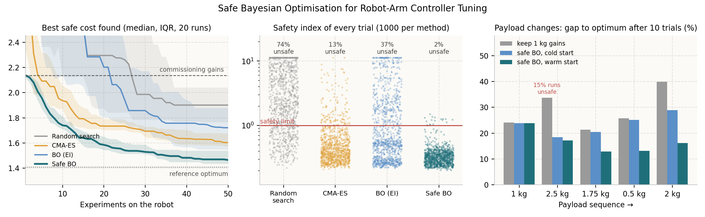
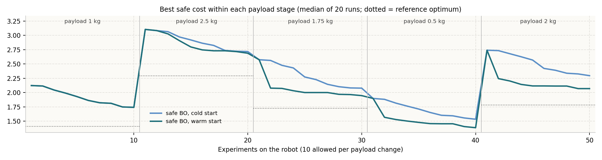

# Safe Bayesian Optimisation for Robot-Arm Controller Tuning

English | [中文](README_zh.md)


**Case study page:** https://dgh19981102-max.github.io/safe-bo-robot-tuning/

Tuning the PID gains of a robot arm is usually done by hand, and every change of payload means doing it again. Letting an algorithm tune on the real machine is attractive, but a bad trial can shake the arm violently or drive it into its surroundings. This project tunes six joint-servo gains automatically with **safe Bayesian optimisation**: Gaussian-process models of performance and safety decide which gains to try next, and only gains that are confidently safe are ever tested. A **contextual** variant re-uses earlier experiments when the payload changes.



## Results

All numbers are medians over 20 independent runs; every trial on the simulated robot counts.

**Tuning from commissioning gains at 1 kg payload (50 trials)**

| Method | Unsafe trials | Gap to optimum after 15 trials | after 50 trials |
|---|---|---|---|
| Random search | 73.8% | 80.2% | 35.1% |
| Standard BO (EI) | 36.8% | 81.1% | 22.3% |
| CMA-ES | 12.7% | 27.4% | 13.9% |
| **Safe BO** | **1.8%** | **16.6%** | **4.1%** |

- Safe BO's few violations were marginal (worst trial 1.5× the limit), while the other methods routinely hit aborted runs.
- Compared with the commissioning gains, the tuned controller halves the RMS tracking error (1.12° → 0.60°) without adding torque ripple.

**Payload changes during operation (1.0 → 2.5 → 1.75 → 0.5 → 2.0 kg, 10 trials per change)**

| Gap to optimum after 10 trials | 2.5 kg | 1.75 kg | 0.5 kg | 2.0 kg |
|---|---|---|---|---|
| Keep the 1 kg gains | 33.7% (15% of runs unsafe) | 21.3% | 25.8% | 39.9% |
| Safe BO, cold start | 18.5% | 20.5% | 25.2% | 28.9% |
| **Safe BO, warm start** | **17.2%** | **12.9%** | **13.1%** | **16.2%** |

After only 3 trials in stages 3–5, the warm start is within 20–25% of the optimum versus 44–50% for a cold start. The price is a small number of marginal violations (11 of 1000 trials, versus 0 for cold start).



## How it works

**Robot.** Two-link arm in a vertical plane with a tip payload, `M(q)q̈ + c(q,q̇) + g(q) + f(q̇) = τ`, including viscous and Coulomb friction, reflected motor inertia, torque limits, a 16-bit noisy encoder and a one-sample control delay. One experiment: brake release with gravity sag, a quintic point-to-point move, a hold, and an external push on joint 1.

**Controller.** Industrial-style independent-joint PID at 500 Hz with filtered derivative on measurement and clamping anti-windup. Six gains are tuned on a log scale.

**Objective and safety.**

- cost = RMS tracking error (deg) + 40 × mean normalised torque increment (penalises noise amplification)
- safety index = max(max error / 8°, torque ripple / 0.12); a trial is safe if the index ≤ 1

Too-soft gains break the error limit; too-aggressive gains break the ripple limit, so the safe region is a band.

**Gaussian process.** Written from scratch: Matérn-5/2 ARD kernel, analytic log-marginal-likelihood gradients, L-BFGS-B restarts. Verified against finite differences and scikit-learn.

**Safe BO.** One GP on log cost, one on log safety. A candidate is eligible only if the safety upper confidence bound `μ + 2.5σ ≤ 0` and it lies within a trust radius of verified safe gains; expected improvement picks among eligible points. The safety GP uses a pessimistic prior mean and capped length scales, so unexplored gains are assumed unsafe until data say otherwise.

**Contextual warm start.** Payload is an extra GP input. Earlier trials at other payloads inform both models, and historical gains that the model predicts to be safe at the new payload become additional trust anchors.

## Quick start

```bash
pip install -r requirements.txt
python -m pytest tests                 # model and GP checks
cd experiments
python e0_reference.py                 # reference optima (long CMA-ES runs)
python e1_sample_efficiency.py         # ~10 min on one core
python e2_payload_sequence.py          # ~10 min on one core
python make_figures.py                 # docs/figures/*.png, results/summary.json
```

## Repository layout

```
├── src/autotune/
│   ├── arm.py            two-link arm dynamics
│   ├── controller.py     joint PID and gain scaling
│   ├── task.py           one closed-loop experiment, cost and safety
│   ├── gp.py             Gaussian process from scratch
│   └── optimizers.py     random search, CMA-ES, BO, safe BO, contextual safe BO
├── experiments/          E0 reference, E1 sample efficiency, E2 payload changes, figures
├── tests/                energy conservation, gravity torque, GP gradient, sklearn match
├── results/              raw traces (JSON) and summary
└── docs/                 case study page and figures
```

## Limitations

- Simulation only; hardware effects such as backlash, flexible joints and thermal drift are not modelled.
- Safety is probabilistic. With noisy measurements, 1.8% of trials slightly exceeded the limit; a larger safety margin or β trades speed for fewer violations.
- The reference optimum comes from long CMA-ES runs and may itself be slightly suboptimal.
- Six gains is a modest dimension; high-dimensional controllers would need structured kernels or embeddings.

## References

1. Berkenkamp F, Krause A, Schoellig A P. Bayesian optimization with safety constraints: safe and automatic parameter tuning in robotics. *Machine Learning*, 2023.
2. Sui Y, Gotovos A, Burdick J, Krause A. Safe exploration for optimization with Gaussian processes. *ICML*, 2015.
3. Krause A, Ong C S. Contextual Gaussian process bandit optimization. *NeurIPS*, 2011.
4. Rasmussen C E, Williams C K I. *Gaussian Processes for Machine Learning*. MIT Press, 2006.
5. Hansen N. The CMA evolution strategy: a tutorial. arXiv:1604.00772, 2016.

## License

MIT, see [LICENSE](LICENSE).
