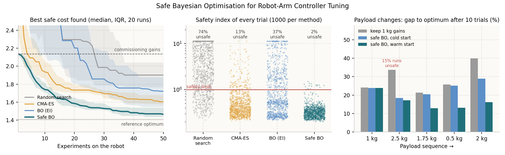

# 安全贝叶斯优化：机械臂控制器自整定

[English](README.md) | 中文

项目展示页：https://dgh19981102-max.github.io/safe-bo-robot-tuning/

机械臂 PID 参数通常靠人工调整，换负载就要重调；在真机上让算法盲目试参数又可能损坏设备。本项目用**安全贝叶斯优化**自动整定两个关节共 6 个 PID 增益：用高斯过程同时建模控制效果和安全程度，只尝试有把握安全的参数；**上下文**版本把负载作为输入，换负载时复用历史实验数据。



## 主要结果（20 次独立重复的中位数）

| 方法（1 kg，50 次实验） | 危险尝试比例 | 15 次后距最优 | 50 次后距最优 |
|---|---|---|---|
| 随机搜索 | 73.8% | 80.2% | 35.1% |
| 标准 BO | 36.8% | 81.1% | 22.3% |
| CMA-ES | 12.7% | 27.4% | 13.9% |
| **安全 BO** | **1.8%** | **16.6%** | **4.1%** |

负载依次变化时（每次 10 次实验），热启动安全 BO 距最优 13～17%，冷启动为 18～29%；沿用 1 kg 参数在 2.5 kg 时有 15% 的运行不安全。

## 运行

```bash
pip install -r requirements.txt
python -m pytest tests
cd experiments && python e0_reference.py && python e1_sample_efficiency.py && python e2_payload_sequence.py && python make_figures.py
```

详细原理、公式推导、设计取舍和常见问答见 **[学习指南](LEARNING_GUIDE_zh.md)**。
